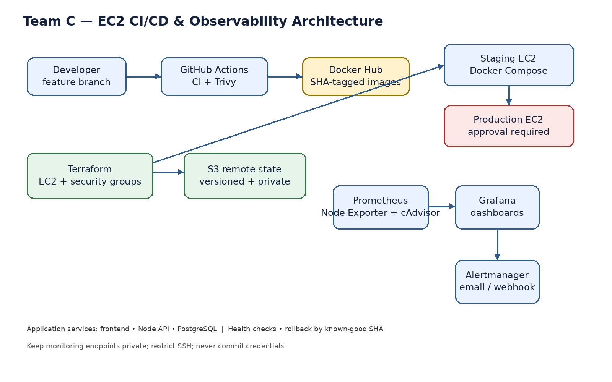
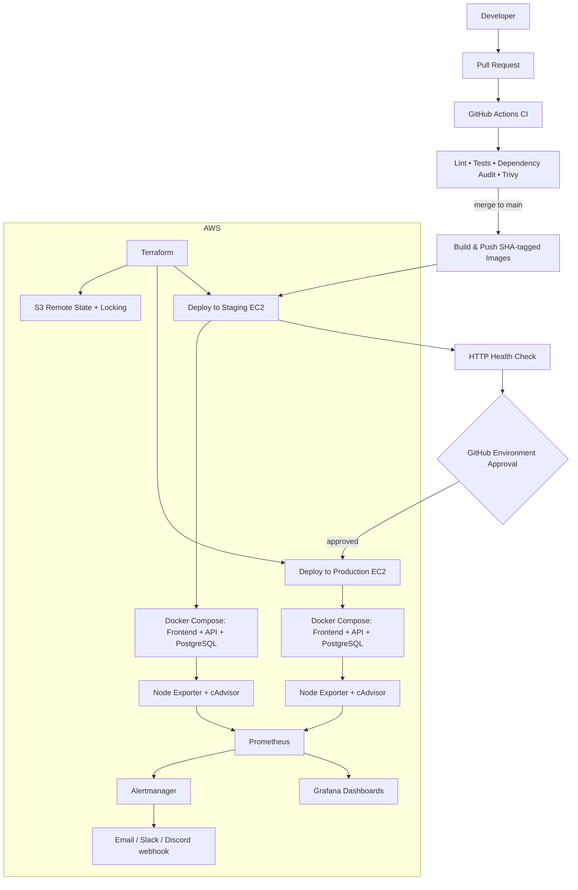

# Team C — Ship and Operate a Containerized Application on AWS EC2

> **Portfolio goal:** demonstrate repeatable infrastructure, automated delivery, security checks, observable services, and safe recovery—not merely running containers.

## Open-source application

This repository is designed to wrap the existing open-source [React + Node.js + PostgreSQL sample](https://github.com/snigdho611/docker-compose-react-nodejs-postgres) as the application under test. Keep the upstream application code attributed to its authors; this repository focuses on the DevOps platform around it. The sample repository's current layout uses `client/` and `server/`. Review its license and current scripts before publishing a fork.

> **Important:** this bundle is a DevOps project scaffold. The sample app is not vendored in this ZIP. Add it as a submodule or clone it into `sample-app/`, then align the Compose build paths and CI commands with the checked-out version before running the workflows.

## Architecture





## Delivery flow

1. Work on a feature branch and open a pull request.
2. GitHub Actions runs linting, tests, `npm audit`, and Trivy scans. Configure branch protection to require the checks.
3. Merging to `main` builds immutable images tagged with the Git commit SHA and pushes them to Docker Hub.
4. The staging job deploys the exact SHA to the staging EC2 host and waits for a health check.
5. Production is a separate GitHub Environment with required reviewers. Approval is required before the production job can access its environment secrets and deploy.
6. Prometheus evaluates availability alerts; Grafana visualizes host/container metrics and application metrics if the API exposes them.

## Repository layout

```text
.
├── .github/workflows/       # PR CI, staging CD, production CD
├── compose/                 # local and server Compose definitions
├── monitoring/              # Prometheus, Alertmanager, Grafana provisioning
├── scripts/                 # health checks, deploy and rollback helpers
├── terraform/               # EC2, security groups, remote state example
├── docs/                    # runbook and presentation plan
├── .env.example
└── README.md
```

## Prerequisites

- Docker Desktop and Docker Compose v2
- Git, Node.js/npm (for checks against the sample app)
- AWS CLI and Terraform
- GitHub repository, Docker Hub account, and two EC2 instances (staging and production)
- SSM or SSH access configured securely; this scaffold uses SSH deploy keys for simplicity
- A dedicated S3 bucket for Terraform state, created before `terraform init`

## 1. Add the open-source sample

Option A — submodule:

```bash
git submodule add https://github.com/snigdho611/docker-compose-react-nodejs-postgres.git sample-app
git submodule update --init --recursive
```

Option B — clone locally for exploration:

```bash
git clone https://github.com/snigdho611/docker-compose-react-nodejs-postgres.git sample-app
```

Before committing, inspect `sample-app/README.md`, its license, `package.json` files, ports, and environment variables. Update `compose/local.yml` build contexts, ports, and health checks to match the checked-out sample. Do not commit `.env` files or credentials.

## 2. Run locally with Docker Desktop

```bash
cp .env.example .env
docker compose -f compose/local.yml up --build -d
docker compose -f compose/local.yml ps
docker compose -f compose/local.yml logs -f
```

Open the frontend URL printed by Compose. Verify the API and database integration using the upstream README's documented endpoints. Stop:

```bash
docker compose -f compose/local.yml down
```

Local development should be validated before pushing code. Do not use production credentials locally.

## 3. Provision AWS with Terraform

The Terraform directory is a reference implementation for EC2 and security groups. It intentionally does **not** create an S3 bucket automatically for its own state: bootstrap the state bucket first, enable versioning, block public access, and restrict access to your IAM identity/role.

```bash
cd terraform
cp terraform.tfvars.example terraform.tfvars
# Edit region, instance type, SSH CIDR, and key name.
terraform init
terraform fmt -check
terraform validate
terraform plan
terraform apply
```

For a production-grade state backend, use S3 versioning and native S3 lock files (`use_lockfile = true`) with a recent Terraform version. Do not put access keys in `.tf` files. Use an AWS profile locally and OIDC-based short-lived credentials from GitHub Actions where possible.

**Cost warning:** EC2, EBS, public IPv4 addresses, data transfer, and monitoring can incur charges. Use the smallest suitable instances, set a budget alert, and destroy resources when not presenting. Never expose SSH to `0.0.0.0/0`; set `allowed_ssh_cidr` to your current public IP `/32`.

## 4. Configure GitHub and Docker Hub

Add these repository or environment secrets:

| Secret | Purpose |
|---|---|
| `DOCKERHUB_USERNAME` | Docker Hub username |
| `DOCKERHUB_TOKEN` | Docker Hub access token (not account password) |
| `STAGING_HOST` | Public DNS/IP of staging EC2 |
| `PRODUCTION_HOST` | Public DNS/IP of production EC2 |
| `DEPLOY_SSH_KEY` | Private deploy key; never commit it |
| `STAGING_KNOWN_HOSTS` | Verified SSH host key entry for staging |
| `PRODUCTION_KNOWN_HOSTS` | Verified SSH host key entry for production |

Create GitHub Environments named `staging` and `production`. Add the host-specific secrets to each environment. Configure **required reviewers** on `production`. Store only the secrets each environment needs. The example workflow expects the EC2 user to have Docker Engine/Compose installed and a checked-out deployment directory.

Configure branch protection on `main` to require CI checks. Do not rely on a workflow `if` condition alone as a substitute for GitHub Environment protection rules.

## 5. Deploy host setup

On each EC2 instance:
- Install and patch Docker Engine plus the Compose plugin.
- Create a dedicated deploy user with limited permissions.
- Configure SSH public-key access; disable password authentication.
- Prepare `/opt/team-c-app` and a server-side `.env` file with restrictive permissions (`chmod 600`).
- Put monitoring config in the deployment directory or deploy it from the repository.
- Permit inbound 80/443 only as needed, SSH only from your IP, and monitoring ports only from trusted sources. Prefer private networking/SSM for long-term use.

Copy `compose/server.yml` and the monitoring configuration to `/opt/team-c-app`. Set registry image names and application environment variables before the first deploy.

## 6. Monitoring and alerting

Prometheus config is in `monitoring/prometheus.yml`; the example alert rule checks whether a scrape target is down. Alertmanager routes alerts to a webhook. Configure the receiver using environment variables or a secret-managed config file. Never commit a webhook URL.

The Compose monitoring profile includes Prometheus, Grafana, Alertmanager, Node Exporter and cAdvisor. Keep Grafana and Prometheus ports private or protect them with a VPN/reverse proxy and authentication. Do not open them publicly without access controls.

For meaningful request-rate and error-rate dashboards, instrument the API with a Prometheus client (for Node.js, `prom-client`) and expose a `/metrics` endpoint. The upstream sample may not include application metrics by default; host/container metrics alone do not provide request rate or HTTP error rate.

## 7. Rollback procedure

This design uses immutable SHA image tags. To roll back:
1. Identify the last known-good Git SHA in GitHub Actions.
2. Re-run the deployment workflow with that SHA, or set the server's image tag to that known-good SHA.
3. Run `docker compose pull` and `docker compose up -d`.
4. Verify the health endpoint, recent logs, and Grafana/Prometheus.
5. Record the incident and root cause in the deployment PR.

Avoid `latest` as the only deploy tag. Database schema changes need backward-compatible migrations; reverting containers does not automatically reverse database changes.

## Runbook: deployment failure

See [`docs/RUNBOOK.md`](docs/RUNBOOK.md).

## Three-week delivery plan

- **Week 1:** inspect upstream sample; local Docker Desktop build; health checks; Dockerfiles/Compose alignment; Terraform and remote state.
- **Week 2:** CI checks and image publishing; staging auto-deploy; production approval; secrets and host hardening.
- **Week 3:** Prometheus/Grafana/Alertmanager; test alert and rollback; screenshots; README polish; rehearse demo.

## 15–20 minute presentation

1. **Problem (2 min):** manual deployments are slow, inconsistent, and hard to audit.
2. **Architecture (3 min):** explain PR checks, immutable images, EC2 environments, remote state, monitoring.
3. **Live demo (7 min):** change one visible UI string; open PR; show CI; merge; show staging deployment and dashboard; approve production promotion.
4. **Failure demo (3 min):** deploy a deliberately unhealthy staging revision; show health-check failure/alert; redeploy the previous SHA. Do this in staging only.
5. **Lessons (3 min):** least privilege, secrets, immutable artifacts, health checks, monitoring gaps, cost controls.
6. **Q&A (2 min).**

## Evidence checklist

- [ ] Architecture diagram
- [ ] Local Docker Desktop containers healthy
- [ ] Passing pull-request checks
- [ ] Trivy/dependency scan results
- [ ] Docker Hub SHA-tagged image
- [ ] Terraform plan/apply and S3 state configuration (redact account IDs)
- [ ] Staging deploy and health-check success
- [ ] Production approval gate
- [ ] Grafana dashboard
- [ ] Alert received during a staging failure test
- [ ] Rollback to known-good SHA
- [ ] No secrets, tokens, IPs or account IDs visible in screenshots

## Upstream attribution

Application sample: [snigdho611/docker-compose-react-nodejs-postgres](https://github.com/snigdho611/docker-compose-react-nodejs-postgres). This repository's Terraform, workflow, monitoring and runbook material is intended as the DevOps layer around that upstream sample. Verify its current license and preserve required notices when redistributing.
